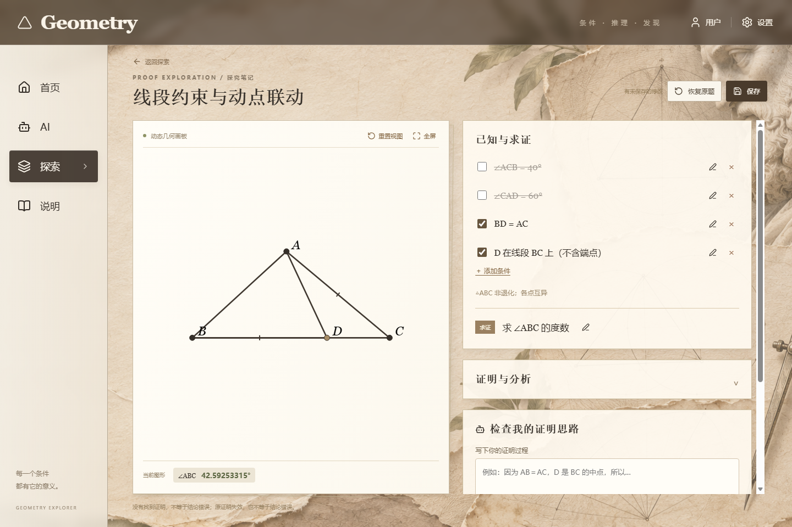
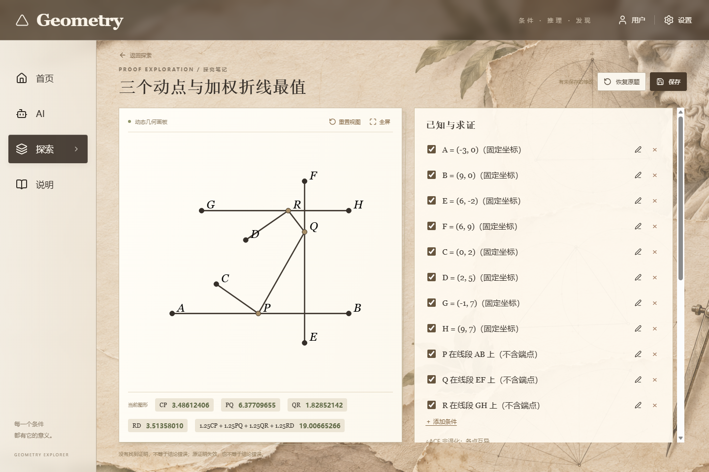

# Geometry · 几何证明探究

Geometry 是一个在本机运行的动态几何工作台，可以探索条件变化、检查证明和反例，并选用 AI 批改思路。

## 画板示例

拖动线段 BC 上的 D 时，A 随之移动，保持 BD = AC。右侧可以开关条件，画板下方实时更新测量值。



三个动点分别沿各自的线段移动，画板实时计算加权折线长度。



## 在新电脑上运行

在 Windows 上安装 Node.js 22.13 或更高版本。下载或克隆本仓库后，在仓库根目录打开 PowerShell：

```powershell
cd geometry-app
node scripts/setup.mjs
npm run dev
```

安装脚本会按锁文件安装 JavaScript 依赖和 Python 3.12 环境。启动后打开 [http://127.0.0.1:3000/](http://127.0.0.1:3000/)。以后也可以在 Windows 上双击根目录的 `启动 Geometry.cmd`。其他系统的安装方式见[应用说明](geometry-app/README.md)。

如果需要使用 NiceGeo 形式化证明检查，请在 `geometry-app/` 下另外运行 `powershell -File scripts/setup-nicegeo.ps1`。仓库保留了固定版本的 [NiceGeo 源码和许可证](geometry-app/vendor/nicegeo/)，安装脚本会重建本机程序。

## 文档和依赖

- 应用代码、测试和题库在 [`geometry-app/`](geometry-app/)；设计、使用和验证文档集中放在 [`geometry-app/docs/`](geometry-app/docs/)。
- `package.json`、`package-lock.json`、`requirements.txt` 和 `requirements.lock.txt` 随代码提交。更新依赖时，提交相应清单和锁文件的变更。
- [`.env.example`](geometry-app/.env.example) 是配置模板。实际 API 密钥按 [AI 配置指南](geometry-app/docs/ai-setup.md) 在本机设置。本机安装的依赖、编译产物、缓存、日志和临时导出由 Git 忽略。
- 自建题和使用记录保存在当前浏览器中；克隆仓库不会同步这些记录。
- 演示截图使用可复现的示例题。原始题图、真实对话、请求记录和测试报告放在本机的 `geometry-app/.local/` 目录。
