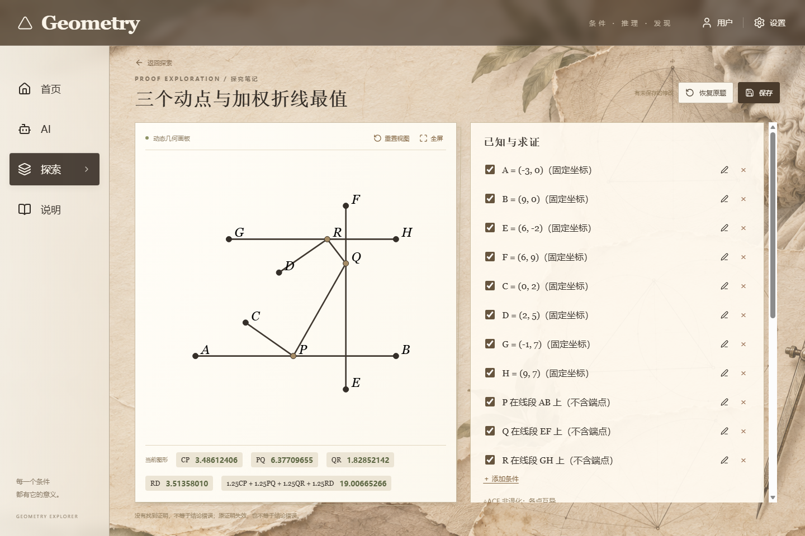

# 动态几何约束与显示验收

最近核对日期为 2026-11-12。

## 2026-11-12 动点联动与视图

- 工作台和新建预览共用同一套拖动求解。先保持参考点，通过约束的局部自由度判断能否继续移动；在必要时只放开关联点，题目给定的固定坐标始终精确保留。
- 拖动派生点也会反向联动。例如，保留 D 在 BC 上及 BD = AC 时，拖动 D 会带动 A，B 和 C 保持原位置。拖动六项加权题中的中点会带动它对应的圆上动点。
- 每帧合并输入并独立核对保留条件、非退化要求和连续分支。窄画板使用等比例取景，松手保留视图；新建确认与保存沿用用户在画板上核对的坐标。
- 轨迹动点和端点重叠时优先选中动点。开线段靠近端点时留出可抓取的屏幕距离，允许端点的圆弧仍可到达端点。对贴端点的旧图，先保留鼠标投影的位置，再求解相连的点。
- 证明依赖、失效前提和步骤沿用共享的数学渲染入口。已保存证明里的行内公式和多行公式也能排版。
- 真实浏览器覆盖已有题、导入预览、创建后拖动和保存重开，检查了三动点与六项加权题的 56 个采样帧，并验证了正方形两端、圆弧端点及保存的证明依赖。前端 158 项、后端 581 项回归通过。

## 2026-11-11 约束核对

录屏中的 on_circle(P,O,Q) 与文字条件 A(-1,2)、B(2,0) 未走统一语义检查：文字坐标被跳过、初始 P=O 仍可显示，失败回退还会恢复未验证的输入坐标。此前松手后的笛卡尔插值会使圆上点沿弦运动，显示中间帧违反条件。

## 统一边界

- 明确、完整的坐标陈述升级为 fixed_point，旧草稿同样适用。固定坐标参与前后端约束与精确验证，不能被参考系归一化移动。不能精确保留的分数和其他未知文字保留原文，并报告未核验；不推测、删除或静默忽略。
- validateDrawing 独立验收所有启用条件、点集合、有限坐标和非退化域，并检查线段、圆与目标的结构引用，防止缺失点导致绘制半张图或崩溃。数值显示容差与严格位置要求分开处理，微小角度使用角差而非不敏感的余弦差。
- projectDrawing 在初次摆放和拖动时保持参考点；轨迹种子只帮助求解，最终仍检查全部条件。初始 P=O 不再让圆心或半径迁就错误坐标。
- 画板只原子显示通过验收的坐标，移除沿弦插值。求解失败保留最后有效帧；新条件无法建立有效图形时隐藏图形并给出状态，不继续显示错误测量。
- 新建题确认、正式页面拖动、后端 sat 回传、保存和 AI 图像入口均受验收约束。未知条件导致后端 unverified 且不返回 points；AI 可继续分析文字，但不附上未经核验的图。
- 新拖动立即取消旧布局请求。题目 ID、版本及请求序号共同防止旧返回覆盖；切换题目清理反例视图和旧结果。readOnly 反例只校验原坐标，不改变反例。
- length_ratio 的共同动点自动显示阿氏圆，比例恰为 1 时显示垂直平分线。轨迹来自实时参考点，不引入独立圆心前提。普通阿氏圆完整纳入视图；接近比例 1 的极大圆保留参考点附近的局部视图。
- 最值候选返回前检查全部保留条件，不能只满足第一条轨迹。
- 拖动事件按刷新帧合并，松手提交最新目标；直接投影优先处理直线、开放线段、圆弧、阿氏圆、中点及定角射线，单锚点角度框架可整体相似联动。仍需优化时只求自由点的相关连通分量，固定点、参考锚点及不相关动点不进入未知量；逐帧设时间预算，超时保留有效帧。
- 图形只更新发生变化的点。1200 次三动点离轨输入未调用 COBYLA，240 次连续输入只产生一次刷新；鼠标松手、条件改变、销毁与迟到响应均有单独回归。

## 验证

- 完整前端测试：144 项独立测试通过（已移除聚合入口重复计数）；TypeScript 无错误。后端完整结果见 `local-repair-20261110.md` 与 `.local/verification/repair-pytest-final.log`。
- 14 种结构化关系、3 个尺度、8 个点、随机点序，共 336 次拖动，每次独立检验条件，全部成功。
- 360 帧整圆、4 种阿氏比各 72 帧、比例 1 的直线轨迹；录屏初值、未知条件、畸形条件、矛盾条件、重合点、零半径、开放线段端点均覆盖。
- Scene 测试记录每次可见渲染边界，验证全部中间帧、无效/空/异常服务返回、迟到返回、readOnly 切换、仅改标题和实时轨迹参数。
- 真实浏览器：录屏同构条件连续一周 32 次采样，圆周残差最大 4.263256414560601e-14 像素；A/B/O/Q 最大漂移 0 像素；控制台无错误。

数值作图验收不是数学证明，也不能保证任意未知自然语言题意已被正确识别。识别出的题干条件仍需与原题核对；无法编码的条件不会被当作已成立。
